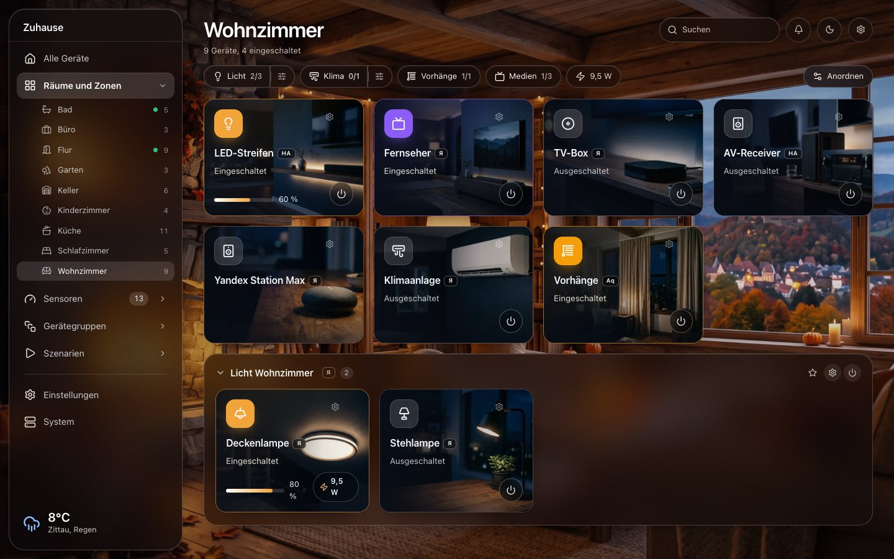
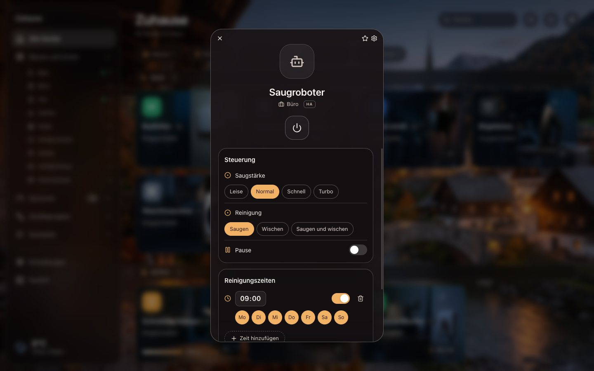
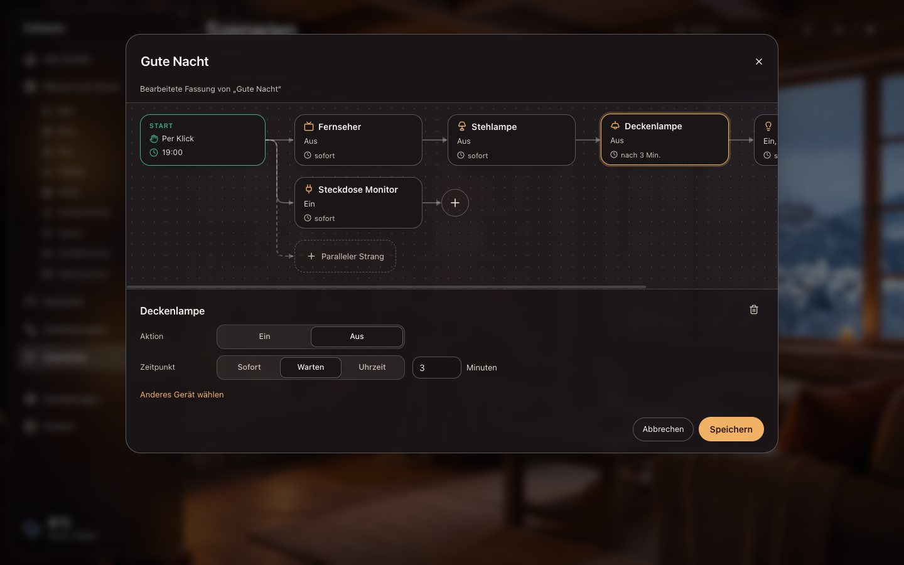
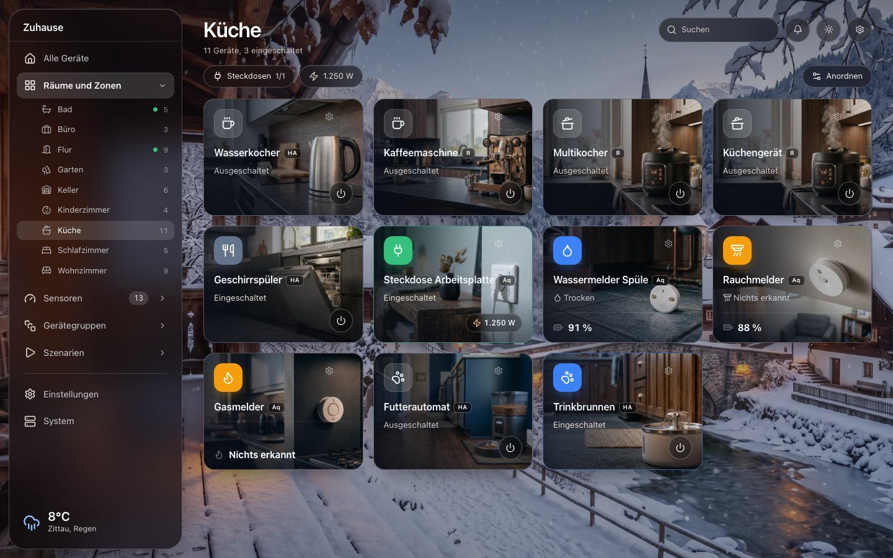
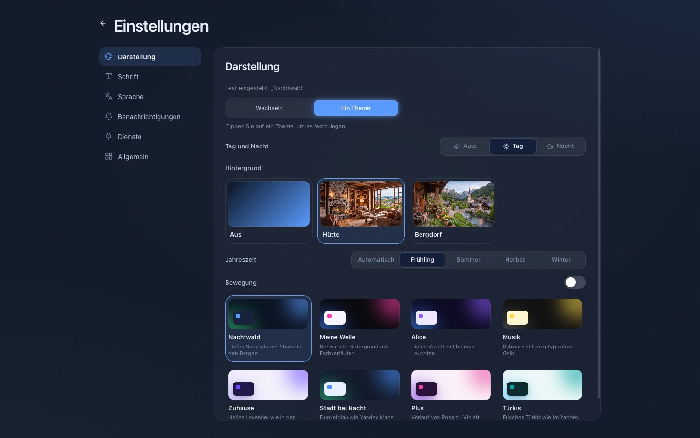

<p align="center">
  
</p>

<h1 align="center">Smart Central</h1>

<p align="center">
  Eine Zentrale am Computer für Yandex, Aqara, Home Assistant und Xiaomi.<br>
  Alle Räume, Geräte und Szenarien in einem Fenster. Kostenlos, quelloffen und lokal.
</p>

<p align="center">
  <a href="README.md">English</a>&nbsp;&nbsp;&nbsp;<b>Deutsch</b>&nbsp;&nbsp;&nbsp;<a href="README.ru.md">Русский</a>
</p>

<p align="center">
  <a href="https://github.com/der-klabautermann/Desktop-Yandex.Home-App/releases/latest"></a>
  <a href="https://github.com/der-klabautermann/Desktop-Yandex.Home-App/releases"></a>
  <a href="#installation"></a>
  <a href="LICENSE"></a>
</p>

<p align="center">
  <a href="https://github.com/der-klabautermann/Desktop-Yandex.Home-App/releases/latest"></a>
</p>

<p align="center">
  <a href="#funktionen">Funktionen</a>&nbsp;&nbsp;&nbsp;
  <a href="#installation">Installation</a>&nbsp;&nbsp;&nbsp;
  <a href="#dienste-verbinden">Dienste verbinden</a>&nbsp;&nbsp;&nbsp;
  <a href="#datenschutz">Datenschutz</a>&nbsp;&nbsp;&nbsp;
  <a href="#selbst-bauen">Selbst bauen</a>
</p>

<p align="center">
  
</p>

Ein Smart Home kommt selten von einem Hersteller. Eine Yandex Station im Wohnzimmer, Aqara-Sensoren im Flur, ein Xiaomi-Saugroboter über Home Assistant: Jeder Hersteller bringt seine eigene App mit, eigene Räume und eigene Szenarien. Smart Central holt alles in ein Fenster. Geräte verschiedener Dienste stehen im selben Raum nebeneinander, lassen sich zu Gruppen zusammenfassen und mit einem einzigen Szenario schalten.

## Funktionen

### Ein Zuhause für alle Dienste

- **Yandex Smart Home, Aqara, Home Assistant und Xiaomi** (Xiaomi über die offizielle Integration in Home Assistant) in einer Ansicht.
- **Räume und Zonen.** Übernimm die Räume deiner Dienste oder lege eigene an: Etagen, Bereiche, einen Garten. Geräte lassen sich umbenennen und in andere Räume verschieben, ohne die Original-Apps anzufassen.
- **Gruppen über Dienste hinweg.** Eine Yandex-Lampe und eine Aqara-Steckdose können eine Gruppe mit einem Schalter sein.
- **Geräte hinzufügen und entfernen.** Anlernen über unterstützte Hubs oder ein direkter Link zur Einrichtungsseite des Dienstes.
- **Ausfälle bleiben sichtbar.** Ist ein Dienst nicht erreichbar, bleiben seine Geräte an ihrem Platz, ausgegraut mit dem letzten bekannten Zustand.

### Geräte

- **Kacheln mit Fotos.** Jeder Gerätetyp hat sein eigenes Bild, in einer Tag- und einer Nachtfassung. Das Symbol auf der Kachel ist der Einschaltknopf, ein Klick öffnet die Details.
- **Bedienung.** Helligkeit, Farbtemperatur, Farbe, Modi, Klima, Vorhänge und mehr, je nachdem, was das Gerät kann.
- **Live-Strommessung.** Leistung, Spannung und Strom werden alle paar Sekunden aktualisiert, solange ein Gerät geöffnet ist. Werte, die das Gerät seit über fünf Minuten nicht gemeldet hat, werden als veraltet markiert.
- **Suche, Filter, Sensoren und Kameras** haben jeweils eine eigene Seite. Favoriten erreichst du über die Menüleiste.

<p align="center">
  
</p>

- **Reinigungszeiten für Saugroboter.** Uhrzeit und Wochentage wählen, Smart Central startet die Reinigung.

### Szenarien als Ablaufdiagramm

<p align="center">
  
</p>

- **Dienste frei mischen.** Eine Yandex-Lampe, eine Aqara-Steckdose und ein Home-Assistant-Licht in einem Szenario.
- **Auslöser.** Start per Klick, zu festen Zeiten an gewählten Wochentagen oder wenn ein Gerät etwas meldet: Bewegung erkannt, Taster gedrückt (einfach, doppelt, lang), Tür geöffnet, Wasser, Rauch, oder ein Gerät wird ein- oder ausgeschaltet.
- **Schritte mit Zeitpunkt.** Jeder Schritt läuft sofort, nach einer Wartezeit (zum Beispiel 10 Minuten nach dem vorherigen Schritt) oder zu einer Uhrzeit.
- **Parallele Stränge** starten gleichzeitig und arbeiten ihre Schritte unabhängig ab.
- **Bearbeiten wie ein Diagramm.** Kacheln ziehen, mehrere mit Shift oder einem Auswahlrahmen wählen, Schritte in eine Verbindung einfügen, einen Strang trennen oder an den darüber anhängen.
- **Yandex-Szenarien bearbeiten.** Öffne ein bestehendes Yandex-Szenario mit allen Geräten und Pausen, ändere es, und deine Fassung ersetzt es in der Liste.

### Aussehen

<p align="center">
  
</p>

- **Animierte Hintergründe.** Eine Hütte und ein Bergdorf, jeweils in vier Jahreszeiten und als Tag- und Nachtfassung. Die Jahreszeit folgt dem Kalender, Tag und Nacht folgen dem echten Sonnenuntergang an deinem Ort. Die Bedienfelder werden zu klarem Glas.
- **Acht Farbthemen**, fest oder im Wechsel, dazu wählbare Schriften.
- **Wetter** für deinen Ort in der Seitenleiste, beim ersten Start automatisch ermittelt.
- **Deutsch, Englisch und Russisch.**

<p align="center">
  
</p>

## Installation

1. Lade den Installer aus dem [neuesten Release](https://github.com/der-klabautermann/Desktop-Yandex.Home-App/releases/latest):
   - `Smart.Central.Setup.vX.Y.Z-arm64.dmg` für Macs mit Apple-Chip (M1 und neuer)
   - `Smart.Central.Setup.vX.Y.Z-x64.dmg` für Macs mit Intel-Prozessor

   Unsicher? Apfel-Menü, Über diesen Mac: Steht dort „Chip“, ist es ein Apple-Chip, steht dort „Prozessor“, ist es Intel.
2. Öffne die `.dmg` und ziehe Smart Central in den Ordner Programme.
3. **Erster Start.** Smart Central ist noch nicht von Apple beglaubigt, deshalb fragt macOS vor dem Öffnen nach. Rechtsklick auf die App, **Öffnen**, dann noch einmal **Öffnen**. Bei neueren macOS-Versionen: einmal öffnen versuchen, dann Systemeinstellungen, Datenschutz & Sicherheit, **Trotzdem öffnen**.

   Meldet macOS, die App sei beschädigt, gib einmal im Terminal ein:

   ```bash
   xattr -dr com.apple.quarantine "/Applications/Smart Central.app"
   ```

Smart Central prüft beim Start, ob es eine neue Version gibt, und sagt dir Bescheid.

Windows und Linux unterstützt der Code bereits, fertige Installer gibt es dafür aber noch nicht. Siehe [Selbst bauen](#selbst-bauen).

## Dienste verbinden

Öffne **System** in der Seitenleiste und füge einen Dienst hinzu. Für jeden gibt es in der App eine Schritt-für-Schritt-Anleitung.

| Dienst | Was du brauchst |
|---|---|
| **Yandex Smart Home** | Einen OAuth-Token. Lege auf [oauth.yandex.ru](https://oauth.yandex.ru/client/new/) eine App an („für den Zugriff auf die API oder zum Debuggen“) mit den Rechten `iot:view` und `iot:control`, trage ihre Client-ID in Smart Central ein und öffne von dort die Token-Seite. Für Kamerabilder bestätigst du zusätzlich einen QR-Code mit der Yandex-App. |
| **Aqara** | Ein kostenloses Entwicklerkonto auf [developer.aqara.com](https://developer.aqara.com/). Lege ein Projekt in der Region deines Aqara-Home-Kontos an und trage App ID, Key ID, App Key und dein Aqara-Konto ein. Aqara schickt einen Bestätigungscode. |
| **Home Assistant** | Die Adresse deines Home Assistant (zum Beispiel `http://homeassistant.local:8123`) und einen langlebigen Zugangstoken aus deinem Home-Assistant-Profil. |
| **Xiaomi** | Füge deine Xiaomi-Geräte mit der offiziellen Integration Xiaomi Home zu Home Assistant hinzu und verbinde dann Home Assistant. |

## Datenschutz

- **Kein Konto, keine Telemetrie, kein eigener Server.** Alles, was Smart Central weiß, bleibt auf deinem Computer.
- **Zugangsdaten liegen im Schlüsselbund** des Systems, nie in offenen Dateien.
- **Verbindungen** gehen nur zu den Diensten, die du verbindest, zu [Open-Meteo](https://open-meteo.com/) für das Wetter, beim ersten Start einmal zu [GeoJS](https://www.geojs.io/), um deinen Ort zu schätzen (änderbar und löschbar), und zu GitHub, um nach neuen Versionen zu sehen.

## Gut zu wissen

- **Zeitpläne und Automationen laufen, solange Smart Central läuft.** Schließt du das Fenster, bleibt die App in der Menüleiste. Verschläft dein Mac eine Startzeit, wird der Start nur innerhalb von fünf Minuten nachgeholt.
- **Geräte-Auslöser** werden alle fünf Sekunden geprüft, eine Reaktion kann also ein paar Sekunden dauern.
- **Sprachbefehle an Alisa** können Szenarien von Smart Central nicht direkt starten, weil Yandex sie nicht an andere Apps weitergibt. Umweg: In der Yandex-App ein Szenario mit deinem Satz anlegen, das ein Gerät schaltet, und in Smart Central „Gerät wird eingeschaltet“ als Auslöser wählen.
- **Bearbeitete Yandex-Szenarien** speichert Smart Central. Das Original bleibt in der Yandex-App, und ein Sprachbefehl an Alisa startet weiterhin das Original.
- **Messwerte sind so aktuell, wie das Gerät sie meldet.** Manche Steckdosen melden nur alle paar Minuten, deshalb werden alte Werte markiert.

## Selbst bauen

Voraussetzung ist Node.js 22 oder neuer.

```bash
git clone https://github.com/der-klabautermann/Desktop-Yandex.Home-App.git
cd Desktop-Yandex.Home-App
npm install
npm run electron-dev
```

- `npm test` führt die Tests aus.
- `npm run dev` öffnet die Oberfläche im Browser mit Beispieldaten. Mit `?mock=all` hinter der Adresse bekommst du ein Showroom-Zuhause mit allen unterstützten Gerätetypen.
- `npm run dist` baut mit electron-builder Installer für das aktuelle System (Windows: NSIS, Linux: AppImage).

## Herkunft und Lizenz

Smart Central entstand als Fork von [Desktop-Yandex.Home-App](https://github.com/onegamerstory/Desktop-Yandex.Home-App) von История Одного Геймера und ist seitdem zu einer Zentrale für mehrere Dienste gewachsen. Veröffentlicht unter der [MIT-Lizenz](LICENSE).
