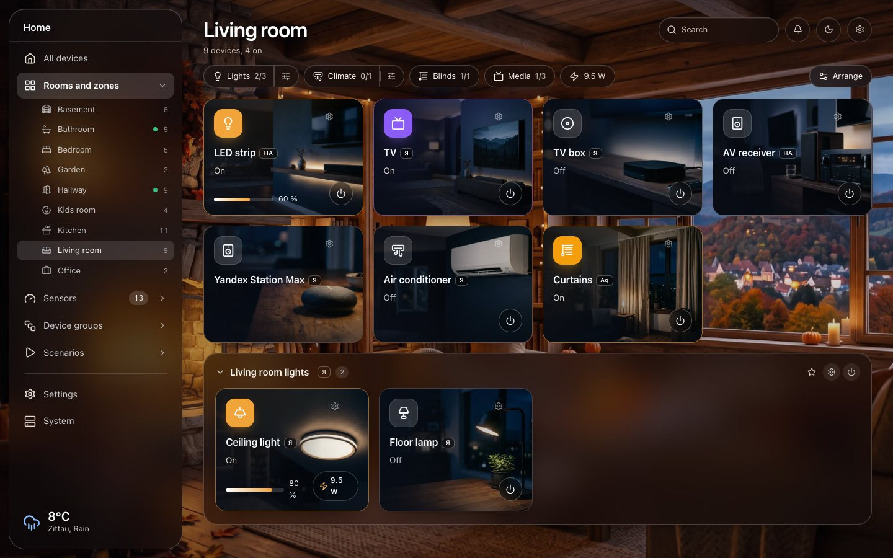
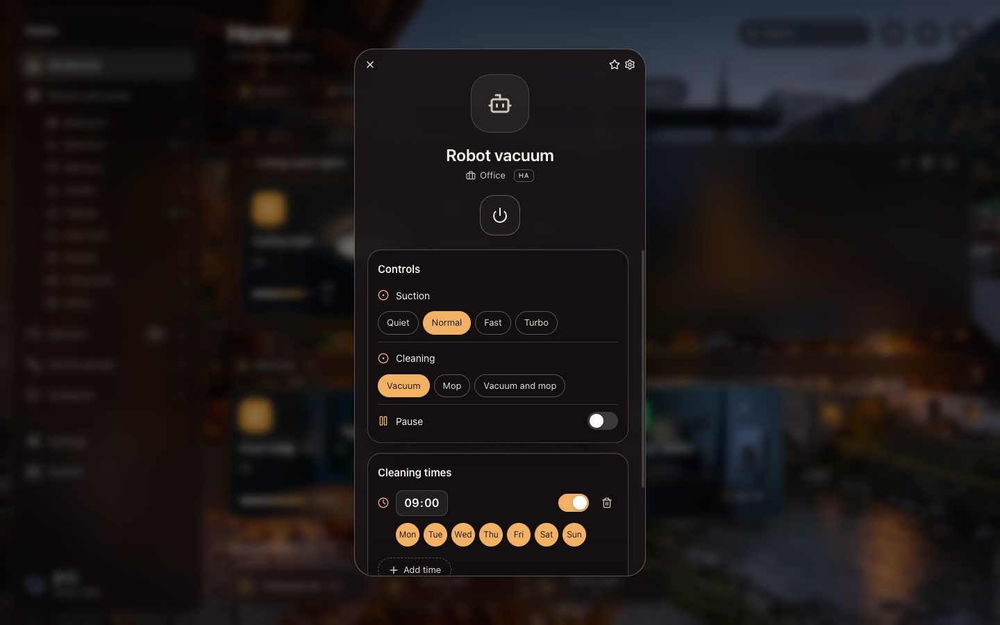
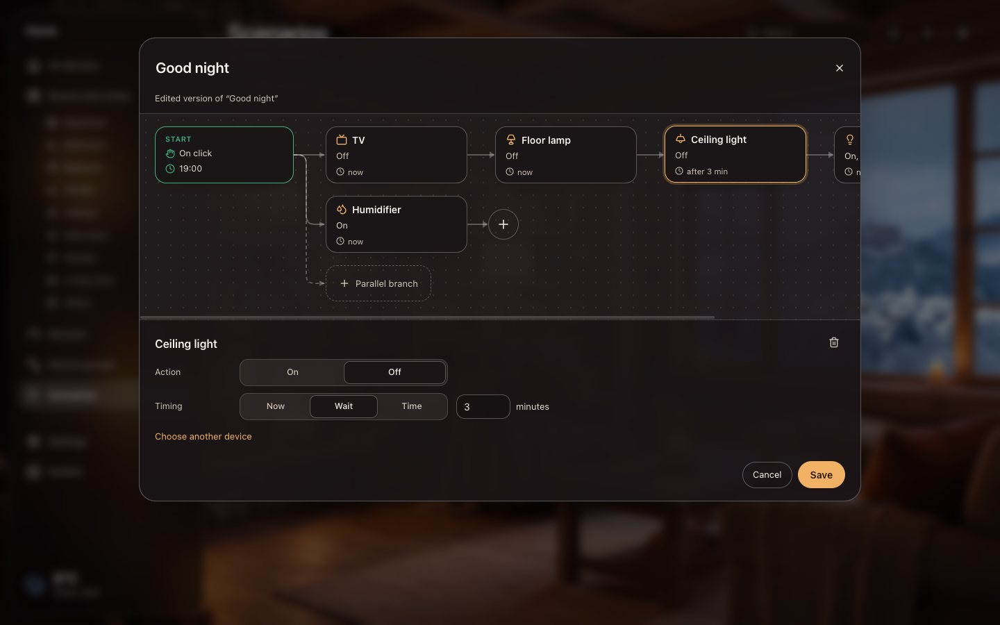
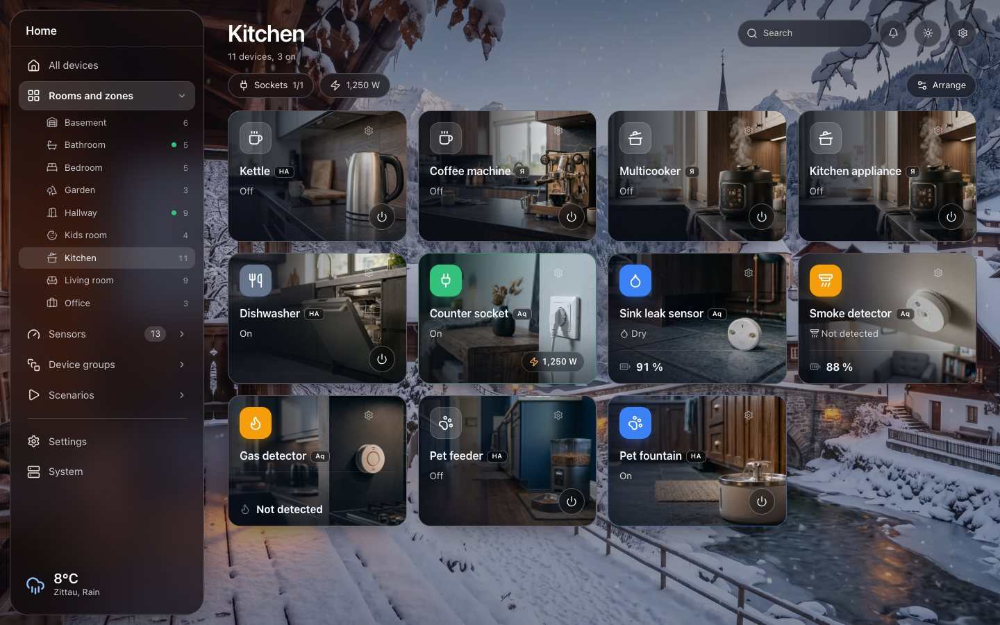
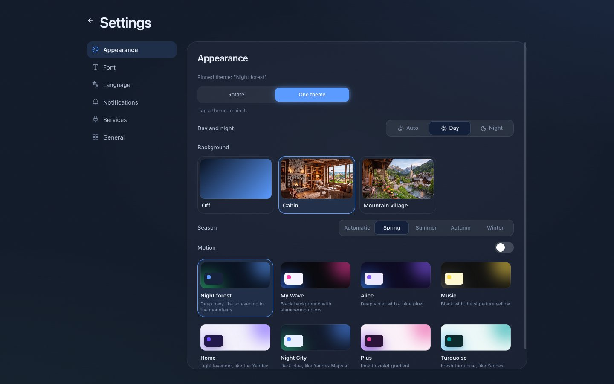

<p align="center">
  
</p>

<h1 align="center">Smart Central</h1>

<p align="center">
  One desktop hub for Yandex, Aqara, Home Assistant and Xiaomi.<br>
  All your rooms, devices and scenarios in one window. Free, open source and local-first.
</p>

<p align="center">
  <b>English</b>&nbsp;&nbsp;&nbsp;<a href="README.de.md">Deutsch</a>&nbsp;&nbsp;&nbsp;<a href="README.ru.md">Русский</a>
</p>

<p align="center">
  <a href="https://github.com/der-klabautermann/Desktop-Yandex.Home-App/releases/latest"></a>
  <a href="https://github.com/der-klabautermann/Desktop-Yandex.Home-App/releases"></a>
  <a href="#install"></a>
  <a href="LICENSE"></a>
</p>

<p align="center">
  <a href="https://github.com/der-klabautermann/Desktop-Yandex.Home-App/releases/latest"></a>
  <a href="https://der-klabautermann.github.io/Desktop-Yandex.Home-App/"></a>
</p>

<p align="center">
  <a href="#everything-it-does">Features</a>&nbsp;&nbsp;&nbsp;
  <a href="#install">Install</a>&nbsp;&nbsp;&nbsp;
  <a href="#connect-your-services">Connect services</a>&nbsp;&nbsp;&nbsp;
  <a href="#private-by-default">Privacy</a>&nbsp;&nbsp;&nbsp;
  <a href="#build-from-source">Build from source</a>
</p>

<p align="center">
  
</p>

Smart homes rarely come from one vendor. A Yandex Station in the living room, Aqara sensors in the hallway, a Xiaomi robot vacuum running through Home Assistant: every vendor ships its own app, its own rooms and its own scenarios. Smart Central brings them into one desktop window. Devices from different services sit side by side in the same room, can be grouped together and can be switched by one scenario.

## Everything it does

### One home for all your services

- **Yandex Smart Home, Aqara, Home Assistant and Xiaomi** (Xiaomi through Home Assistant's official integration) in one view.
- **Rooms and zones.** Use the rooms of your services or create your own: floors, areas, a garden. Rename devices and move them between rooms without touching the original apps.
- **Groups across services.** A Yandex lamp and an Aqara plug can be one group with one switch.
- **Add and remove devices.** Pairing through supported hubs, or a direct link to the service's own setup page.
- **Outages stay visible.** If a service is unreachable, its devices stay in place, greyed out with their last known state.

### Devices

- **Tiles with photos.** Every device type has its own picture, with a day and a night version. The icon on a tile is the power button, a click opens the details.
- **Controls.** Brightness, color temperature, color, modes, climate settings, curtains and more, depending on what the device supports.
- **Live energy readings.** Power, voltage and current refresh every few seconds while a device is open. Values a device has not reported for over five minutes are marked as stale.
- **Search, filters, sensors and cameras** each have their own page. Favorites are available from the menu bar.

<p align="center">
  
</p>

- **Robot vacuum schedules.** Pick times and weekdays, Smart Central starts the cleaning.

### Scenarios as a flowchart

<p align="center">
  
</p>

- **Mix services freely.** A Yandex lamp, an Aqara plug and a Home Assistant light in one scenario.
- **Triggers.** Start on click, at fixed times on chosen weekdays, or when a device reports something: motion detected, a button pressed (single, double, long), a door opened, a leak, smoke, or a device being switched on or off.
- **Steps with timing.** Every step runs immediately, after a wait (for example 10 minutes after the previous step) or at a clock time.
- **Parallel branches** start at the same time and run their steps independently.
- **Edit like a diagram.** Drag tiles, select several with Shift or a selection frame, insert steps into a connection, split a branch or attach it to the one above.
- **Edit Yandex scenarios.** Open an existing Yandex scenario with all its devices and pauses, change it, and your version replaces it in the list.

### Looks

<p align="center">
  
</p>

- **Animated backgrounds.** A cabin and a mountain village, each in four seasons and in day and night versions. The season follows the calendar, day and night follow the real sunset at your location. Panels turn into clear glass.
- **Eight color themes**, fixed or rotating, plus fonts to choose from.
- **Weather** for your location in the sidebar, found automatically on first start.
- **English, German and Russian.**

<p align="center">
  
</p>

## Install

1. Download the installer from the [latest release](https://github.com/der-klabautermann/Desktop-Yandex.Home-App/releases/latest):
   - `Smart.Central.Setup.vX.Y.Z-arm64.dmg` for Macs with Apple silicon (M1 and newer)
   - `Smart.Central.Setup.vX.Y.Z-x64.dmg` for Macs with an Intel processor

   Not sure which one? Apple menu, About This Mac: "Chip" means Apple silicon, "Processor" means Intel.
2. Open the `.dmg` and drag Smart Central into Applications.
3. **First start.** Smart Central is not notarized by Apple yet, so macOS asks before opening it. Right-click the app, choose **Open**, then **Open** again. On newer macOS versions: try to open it once, then go to System Settings, Privacy & Security, and click **Open Anyway**.

   If macOS says the app is damaged, run this once in Terminal:

   ```bash
   xattr -dr com.apple.quarantine "/Applications/Smart Central.app"
   ```

Smart Central checks for new releases on start and tells you when an update is available.

Windows and Linux are supported by the code base but there are no ready-made installers yet. See [Build from source](#build-from-source).

## Connect your services

Open **System** in the sidebar and add a service. Each one has a step-by-step guide inside the app.

| Service | What you need |
|---|---|
| **Yandex Smart Home** | An OAuth token. Create an app at [oauth.yandex.ru](https://oauth.yandex.ru/client/new/) ("for API access or debugging") with the permissions `iot:view` and `iot:control`, paste its Client ID into Smart Central and open the token page from there. For camera streams the app additionally asks you to confirm a QR code with the Yandex app. |
| **Aqara** | A free developer account at [developer.aqara.com](https://developer.aqara.com/). Create a project in the region of your Aqara Home account, then enter App ID, Key ID, App Key and your Aqara account. Aqara sends a confirmation code. |
| **Home Assistant** | The address of your Home Assistant (for example `http://homeassistant.local:8123`) and a long-lived access token from your Home Assistant profile. |
| **Xiaomi** | Add your Xiaomi devices to Home Assistant with the official Xiaomi Home integration, then connect Home Assistant. |

## Private by default

- **No account, no telemetry, no own server.** Everything Smart Central knows stays on your computer.
- **Credentials live in the system keychain** (macOS Keychain), never in plain files.
- **Network traffic** goes only to the services you connect, to [Open-Meteo](https://open-meteo.com/) for the weather, once to [GeoJS](https://www.geojs.io/) to guess your location on first start (you can change or remove it), and to GitHub to check for new releases.

## Good to know

- **Schedules and automations run while Smart Central is running.** Closing the window keeps it in the menu bar. If your Mac sleeps through a start time, the start is caught up only within five minutes.
- **Device triggers** are checked every five seconds, so a reaction can take a few seconds.
- **Alice voice commands** cannot start Smart Central scenarios directly, because Yandex does not share them with other apps. Workaround: create a Yandex scenario with your phrase that switches a device, and use "device is turned on" as the trigger in Smart Central.
- **Edited Yandex scenarios** are stored in Smart Central. The original stays in the Yandex app, and a voice command to Alice still runs the original.
- **Readings are only as fresh as the device reports them.** Some plugs report every few minutes, which is why stale values are marked.

## Build from source

Requires Node.js 22 or newer.

```bash
git clone https://github.com/der-klabautermann/Desktop-Yandex.Home-App.git
cd Desktop-Yandex.Home-App
npm install
npm run electron-dev
```

- `npm test` runs the test suite.
- `npm run dev` opens the interface in a browser with demo data. Add `?mock=all` to the address to get a showroom home with every supported device type.
- `npm run dist` builds installers for the current platform with electron-builder (Windows: NSIS, Linux: AppImage).

## Credits and license

Smart Central started as a fork of [Desktop-Yandex.Home-App](https://github.com/onegamerstory/Desktop-Yandex.Home-App) by История Одного Геймера and has since grown into a multi-service hub. Released under the [MIT license](LICENSE).
