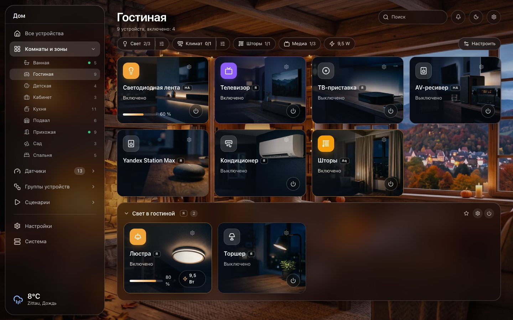
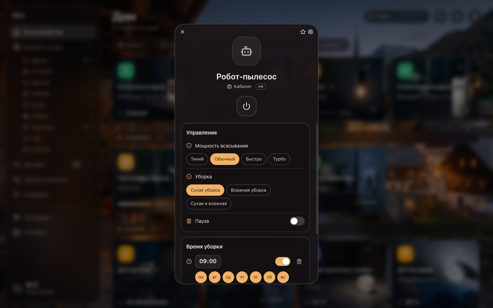
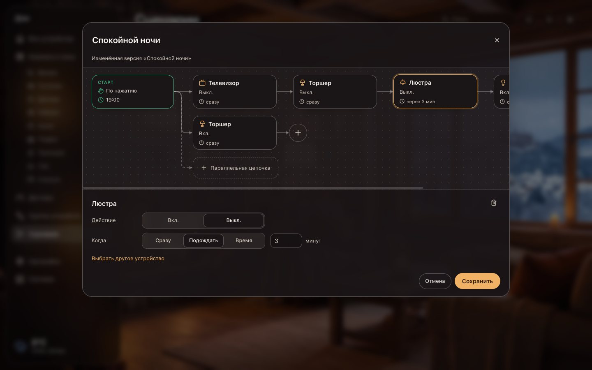
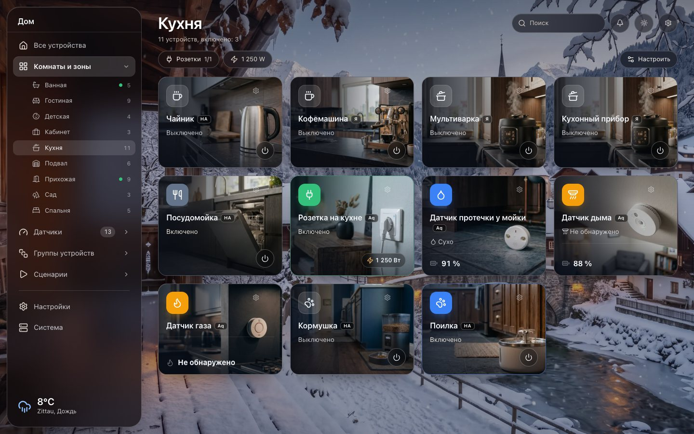
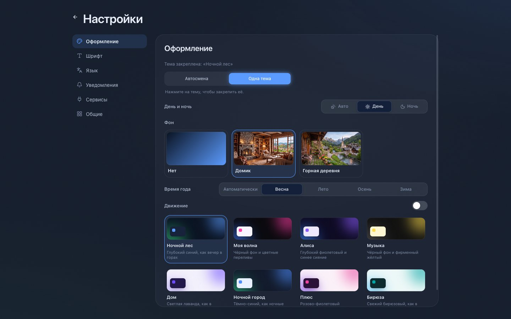

<p align="center">
  
</p>

<h1 align="center">Smart Central</h1>

<p align="center">
  Один центр на компьютере для Яндекса, Aqara, Home Assistant и Xiaomi.<br>
  Все комнаты, устройства и сценарии в одном окне. Бесплатно, с открытым кодом и без облака.
</p>

<p align="center">
  <a href="README.md">English</a>&nbsp;&nbsp;&nbsp;<a href="README.de.md">Deutsch</a>&nbsp;&nbsp;&nbsp;<b>Русский</b>
</p>

<p align="center">
  <a href="https://github.com/der-klabautermann/Desktop-Yandex.Home-App/releases/latest"></a>
  <a href="https://github.com/der-klabautermann/Desktop-Yandex.Home-App/releases"></a>
  <a href="#установка"></a>
  <a href="LICENSE"></a>
</p>

<p align="center">
  <a href="https://github.com/der-klabautermann/Desktop-Yandex.Home-App/releases/latest"></a>
</p>

<p align="center">
  <a href="#возможности">Возможности</a>&nbsp;&nbsp;&nbsp;
  <a href="#установка">Установка</a>&nbsp;&nbsp;&nbsp;
  <a href="#подключение-сервисов">Подключение сервисов</a>&nbsp;&nbsp;&nbsp;
  <a href="#конфиденциальность">Конфиденциальность</a>&nbsp;&nbsp;&nbsp;
  <a href="#сборка-из-исходников">Сборка из исходников</a>
</p>

<p align="center">
  
</p>

Умный дом редко бывает от одного производителя. Яндекс Станция в гостиной, датчики Aqara в прихожей, робот-пылесос Xiaomi через Home Assistant: у каждого производителя своё приложение, свои комнаты и свои сценарии. Smart Central собирает всё в одном окне. Устройства разных сервисов стоят рядом в одной комнате, объединяются в группы и включаются одним сценарием.

## Возможности

### Один дом для всех сервисов

- **Умный дом Яндекса, Aqara, Home Assistant и Xiaomi** (Xiaomi через официальную интеграцию в Home Assistant) в одном окне.
- **Комнаты и зоны.** Берите комнаты из сервисов или создавайте свои: этажи, зоны, сад. Устройства можно переименовывать и переносить в другие комнаты, не трогая родные приложения.
- **Группы из разных сервисов.** Лампа Яндекса и розетка Aqara могут быть одной группой с одним выключателем.
- **Добавление и удаление устройств.** Подключение через поддерживаемые хабы или прямая ссылка на страницу настройки сервиса.
- **Сбои видны сразу.** Если сервис недоступен, его устройства остаются на месте, серыми, с последним известным состоянием.

### Устройства

- **Плитки с фотографиями.** У каждого типа устройства своя картинка, в дневном и ночном варианте. Значок на плитке включает и выключает устройство, щелчок открывает подробности.
- **Управление.** Яркость, цветовая температура, цвет, режимы, климат, шторы и многое другое, в зависимости от устройства.
- **Энергопотребление в реальном времени.** Мощность, напряжение и ток обновляются каждые несколько секунд, пока устройство открыто. Значения, которые устройство не присылало больше пяти минут, помечаются как устаревшие.
- **Поиск, фильтры, датчики и камеры** на отдельных страницах. Избранное доступно из строки меню.

<p align="center">
  
</p>

- **Расписание уборки.** Выберите время и дни недели, Smart Central сам запустит пылесос.

### Сценарии в виде схемы

<p align="center">
  
</p>

- **Любые сервисы вместе.** Лампа Яндекса, розетка Aqara и свет из Home Assistant в одном сценарии.
- **Запуск.** По нажатию, в заданное время в выбранные дни или по событию устройства: обнаружено движение, нажата кнопка (один раз, дважды, долго), открыта дверь, протечка, дым, устройство включилось или выключилось.
- **Шаги со временем.** Каждый шаг выполняется сразу, после паузы (например, через 10 минут после предыдущего) или в заданное время.
- **Параллельные цепочки** стартуют одновременно и выполняют свои шаги независимо.
- **Редактирование как схемы.** Перетаскивайте плитки, выделяйте несколько с Shift или рамкой, вставляйте шаги в связь, разрывайте цепочку или присоединяйте её к цепочке выше.
- **Изменение сценариев Яндекса.** Откройте готовый сценарий Яндекса со всеми устройствами и паузами, измените его, и ваша версия заменит его в списке.

### Внешний вид

<p align="center">
  
</p>

- **Анимированные фоны.** Домик и горная деревня, каждый в четырёх временах года, днём и ночью. Время года идёт по календарю, день и ночь по настоящему закату в вашем городе. Панели становятся прозрачным стеклом.
- **Восемь цветовых тем**, постоянных или по очереди, и выбор шрифтов.
- **Погода** для вашего города в боковой панели, город определяется при первом запуске.
- **Русский, английский и немецкий.**

<p align="center">
  
</p>

## Установка

1. Скачайте установщик из [последнего релиза](https://github.com/der-klabautermann/Desktop-Yandex.Home-App/releases/latest):
   - `Smart.Central.Setup.vX.Y.Z-arm64.dmg` для Mac с чипом Apple (M1 и новее)
   - `Smart.Central.Setup.vX.Y.Z-x64.dmg` для Mac с процессором Intel

   Не уверены? Меню Apple, «Об этом Mac»: «Чип» означает чип Apple, «Процессор» означает Intel.
2. Откройте `.dmg` и перетащите Smart Central в папку «Программы».
3. **Первый запуск.** Smart Central пока не заверен Apple, поэтому macOS спрашивает разрешение. Щёлкните по приложению правой кнопкой, выберите **Открыть**, затем ещё раз **Открыть**. В новых версиях macOS: попробуйте открыть один раз, затем «Системные настройки», «Конфиденциальность и безопасность», **Всё равно открыть**.

   Если macOS пишет, что приложение повреждено, один раз выполните в Терминале:

   ```bash
   xattr -dr com.apple.quarantine "/Applications/Smart Central.app"
   ```

При запуске Smart Central проверяет, есть ли новая версия, и сообщает об этом.

Windows и Linux код уже поддерживает, но готовых установщиков для них пока нет. См. [Сборка из исходников](#сборка-из-исходников).

## Подключение сервисов

Откройте **Система** в боковой панели и добавьте сервис. Для каждого в приложении есть пошаговая инструкция.

| Сервис | Что понадобится |
|---|---|
| **Умный дом Яндекса** | OAuth-токен. Создайте приложение на [oauth.yandex.ru](https://oauth.yandex.ru/client/new/) («Для доступа к API или отладки») с правами `iot:view` и `iot:control`, вставьте его ClientID в Smart Central и откройте оттуда страницу токена. Для видео с камер приложение дополнительно попросит подтвердить QR-код в приложении Яндекса. |
| **Aqara** | Бесплатный аккаунт разработчика на [developer.aqara.com](https://developer.aqara.com/). Создайте проект в регионе вашего аккаунта Aqara Home и введите App ID, Key ID, App Key и ваш аккаунт Aqara. Aqara пришлёт код подтверждения. |
| **Home Assistant** | Адрес вашего Home Assistant (например, `http://homeassistant.local:8123`) и долгосрочный токен доступа из профиля Home Assistant. |
| **Xiaomi** | Добавьте устройства Xiaomi в Home Assistant через официальную интеграцию Xiaomi Home, затем подключите Home Assistant. |

## Конфиденциальность

- **Без аккаунта, без телеметрии, без своего сервера.** Всё, что знает Smart Central, остаётся на вашем компьютере.
- **Данные для входа хранятся в связке ключей** системы, а не в открытых файлах.
- **Соединения** идут только к подключённым сервисам, к [Open-Meteo](https://open-meteo.com/) за погодой, один раз при первом запуске к [GeoJS](https://www.geojs.io/), чтобы примерно определить город (его можно изменить или удалить), и к GitHub для проверки новых версий.

## Полезно знать

- **Расписания и автоматизации работают, пока запущен Smart Central.** Если закрыть окно, приложение остаётся в строке меню. Если Mac спал во время запуска, запуск догоняется только в течение пяти минут.
- **События устройств** проверяются каждые пять секунд, поэтому реакция может занять несколько секунд.
- **Голосовые команды Алисе** не могут напрямую запускать сценарии Smart Central, потому что Яндекс не передаёт их другим приложениям. Обходной путь: создайте в приложении Яндекса сценарий с вашей фразой, который переключает устройство, и выберите в Smart Central событие «устройство включается».
- **Изменённые сценарии Яндекса** хранятся в Smart Central. Оригинал остаётся в приложении Яндекса, и голосовая команда Алисе по-прежнему запускает оригинал.
- **Показания свежие настолько, насколько часто их присылает устройство.** Некоторые розетки отправляют данные раз в несколько минут, поэтому устаревшие значения помечаются.

## Сборка из исходников

Нужен Node.js 22 или новее.

```bash
git clone https://github.com/der-klabautermann/Desktop-Yandex.Home-App.git
cd Desktop-Yandex.Home-App
npm install
npm run electron-dev
```

- `npm test` запускает тесты.
- `npm run dev` открывает интерфейс в браузере с демо-данными. Добавьте `?mock=all` к адресу, чтобы получить дом-выставку со всеми поддерживаемыми типами устройств.
- `npm run dist` собирает установщики для текущей системы через electron-builder (Windows: NSIS, Linux: AppImage).

## Происхождение и лицензия

Smart Central появился как форк приложения [Desktop-Yandex.Home-App](https://github.com/onegamerstory/Desktop-Yandex.Home-App) от «История Одного Геймера» и вырос в центр для нескольких сервисов. Распространяется по [лицензии MIT](LICENSE).
